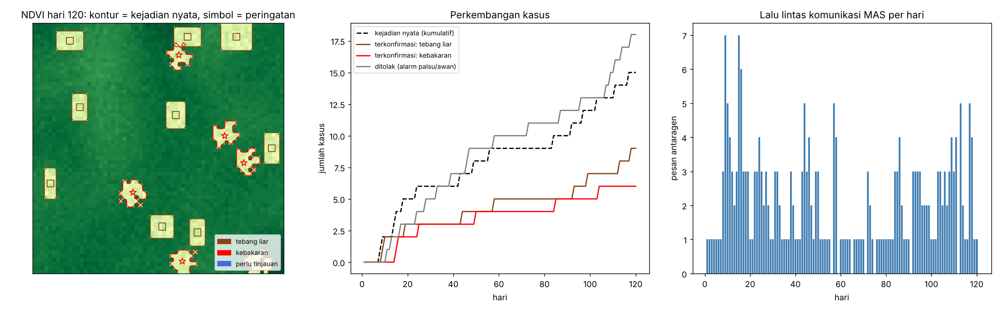

# 🌳🔥 Multi-Agent Deforestation & Fire Monitoring System

Sistem multi-agen (MAS) berbasis **[Mesa](https://github.com/mesa/mesa)** yang memantau citra satelit
secara terus-menerus untuk mendeteksi **tebang liar** dan **kebakaran hutan**. Agen tidak menyimpulkan
sendiri: setiap wilayah yang dicurigai harus disepakati (konsensus) oleh dua agen dengan sumber bukti
berbeda sebelum peringatan dikirim ke pihak berwenang.

> Tahap saat ini memakai **lingkungan satelit sintetis** (NDVI optik + suhu termal mirip MODIS) yang
> dilengkapi *ground truth*, sehingga kinerja sistem bisa diukur. Lihat
> [Menuju data nyata](#-menuju-data-nyata-google-earth-engine) untuk tahap berikutnya.

---

## 1. Peran agen

| Agen | Kelas | Tugas |
| :--- | :--- | :--- |
| **Agen Pengunduh** | `DataIngestionAgent` | Memantau *cloud storage*, mengunduh citra baru, dan mencoba ulang unduhan yang gagal. |
| **Agen Deteksi Perubahan** | `ChangeDetectionAgent` | Membandingkan citra hari ini dengan komposit median citra **minggu lalu** (H-9 s.d. H-5), mencari area hijau yang hilang drastis, lalu memeriksa apakah kehilangan itu **menetap**. Jumlahnya bisa lebih dari satu; wilayah dibagi per detektor. |
| **Agen Validasi** | `ValidationAgent` | Memeriksa anomali **suhu permukaan (termal)** di wilayah curiga: sangat panas → kebakaran, sedikit hangat → tebang liar, lebih dingin → awan/alarm palsu. Bisa lebih dari satu; tugas dibagi ke validator dengan antrean tersingkat (*load balancing*). |
| **Agen Notifikasi** | `NotificationAgent` | Menerima laporan hasil konsensus, menentukan prioritas dan kanal tujuan, mengirim peringatan, dan memperbarui peringatan bila area kebakaran meluas. |

## 2. Interaksi & konsensus

```
 Pengunduh ──INFORM new_scene──▶ Deteksi ──REQUEST validate──▶ Validasi
                                    ▲                              │
                                    └──────PROPOSE verdict─────────┘
            konsensus tercapai ──CONFIRM / CANCEL──▶ Validasi
 Deteksi ──INFORM report──▶ Notifikasi ──▶ Tim Pemadam / Polisi Hutan / Analis
```

Pesan memakai *performative* bergaya **FIPA-ACL** (`inform`, `request`, `propose`, `confirm`, `cancel`)
dan `conversation_id` per kasus, sehingga setiap kasus bisa dilacak dari awal sampai akhir.

**Aturan konsensus** (dua bukti independen):

| Suara Deteksi (NDVI menetap?) | Suara Validasi (termal) | Keputusan |
| :---: | :---: | :--- |
| ya | nyata (tebang/kebakaran) | ✅ **CONFIRMED** → peringatan |
| tidak | tidak nyata (awan) | ❌ **DISMISSED** (alarm palsu) |
| berbeda | berbeda | 🔁 ronde ulang dengan data hari berikutnya (maks. 2 ronde) |
| masih berbeda | masih berbeda | ⚠️ **UNCERTAIN** → dikirim untuk tinjauan manual |

| Penyebab | Prioritas | Kanal |
| :--- | :--- | :--- |
| Kebakaran | DARURAT | Tim Pemadam Kebakaran Hutan |
| Tebang liar | TINGGI | Polisi Hutan / Dinas Kehutanan |
| Tidak pasti | RENDAH | Analis GIS (tinjauan manual) |

## 3. Kaitan dengan materi MAS (P05)

- **Background of MAS**: setiap agen terbatas (citra optik tertutup awan, termal tidak melihat vegetasi),
  sehingga mereka menggabungkan sumber daya untuk satu tujuan bersama.
- **Tipe agen**: Pengunduh adalah *simple reflex agent* (ada citra baru → unduh). Deteksi adalah
  *model-based* (menyimpan komposit acuan dan riwayat kasus). Validasi bersifat *goal/utility-based*
  (memilih penyebab dan memberi tingkat keyakinan).
- **Interaksi antaragen**: protokol request–propose–confirm dan konsensus dua pihak.

## 4. Lingkungan sintetis

`ForestEnvironment` membangkitkan hutan 64×64 sel (±1 ha/sel) dengan:

- **Tebang liar**: petak persegi, NDVI turun permanen, suhu naik ±2 °C.
- **Kebakaran**: titik api yang menyebar 2 hari, anomali termal +18–30 °C yang meluruh.
- **Awan (pengecoh)**: NDVI turun sementara 1–2 hari, suhu justru turun. Dari citra optik saja, awan
  terlihat seperti deforestasi.
- Gangguan nyata: noise sensor, musim, unduhan gagal (5%), dan data termal hilang (5%).

## 5. Hasil (120 hari, seed 42)

| Metrik | MAS (konsensus) | Detektor tunggal |
| :--- | ---: | ---: |
| Kasus terkonfirmasi | 15 | 42 |
| Alarm palsu | **0** | 12 |
| Recall | 1.00 | 1.00 |
| Precision | **1.00** | 0.71 |
| Akurasi penyebab | 1.00 | – |
| Latensi rata-rata (hari) | 1.20 | 0.20 |

Rata-rata 10 seed (0–9): MAS mencapai recall ≈0,99, precision 1,00, dan akurasi penyebab ≈0,99, tanpa alarm
palsu. Detektor tunggal juga mencapai recall 1,00, tetapi precision-nya hanya ≈0,65 karena rata-rata
menghasilkan 14 alarm palsu per run. Harga yang dibayar adalah latensi sekitar 1 hari, karena konsensus membutuhkan citra hari
berikutnya. Kegagalan yang tersisa terjadi saat tebang liar berlangsung tepat di bawah awan; kasus seperti ini
dikirim sebagai *uncertain* untuk ditinjau manusia.



## 6. Cara menjalankan

```bash
cd Deforestation_MAS
pip install -r requirements.txt

python run_simulation.py                              # 120 hari, seed 42
python run_simulation.py --compare                    # MAS vs detektor tunggal
python run_simulation.py --detectors 3 --validators 2 # lebih banyak agen
python run_simulation.py --days 180 --seed 7 --quiet
python -m pytest -q tests                             # 12 pengujian
```

Di Windows, cukup klik ganda `Jalankan_Deforestation_MAS.bat` di root repositori.
Hasil tersimpan di `output/`: `alerts.json` (semua peringatan beserta bukti), `timeseries.csv`
(data `DataCollector` Mesa per hari), dan `simulation.png`.

## 7. Struktur kode

```
Deforestation_MAS/
├── deforestation_mas/
│   ├── environment.py   # lingkungan satelit sintetis + ground truth
│   ├── messaging.py     # MessageBus & pesan bergaya FIPA-ACL
│   ├── agents.py        # 4 agen + logika konsensus
│   ├── model.py         # mesa.Model: pipeline harian & DataCollector
│   └── evaluation.py    # recall, precision, akurasi penyebab, latensi
├── tests/test_mas.py
├── run_simulation.py
└── requirements.txt
```

## 8. 🛰️ Menuju data nyata (Google Earth Engine)

Agen hanya memakai empat metode dari lingkungan: `available_days()`, `download(day)`,
`fetch_thermal(day)`, dan `to_latlon(r, c)`. Untuk data nyata, cukup buat kelas baru dengan antarmuka
yang sama, misalnya:

- `download()` mengambil NDVI Sentinel-2 (`COPERNICUS/S2_SR_HARMONIZED`) dengan masker awan, via
  `earthengine-api`/`geemap`.
- `fetch_thermal()` mengambil MODIS LST (`MODIS/061/MOD11A1`) dan/atau titik api aktif
  (`FIRMS`, `MODIS/061/MOD14A1`).
- `to_latlon()` memakai transformasi georeferensi raster yang sebenarnya.

Ambang (`drop_threshold`, `fire_anomaly`, `cloud_anomaly`) perlu dikalibrasi ulang dengan data nyata.

## 9. Ide pengembangan berikutnya

- **Agen Masker Awan** khusus yang memakai band QA citra, sehingga lebih sedikit kasus awan yang masuk validasi.
- **Agen Validasi kedua** berbasis radar (Sentinel-1) yang bisa melihat menembus awan, untuk menyelesaikan kasus *uncertain*.
- **Voting tiga pihak** atau *contract-net protocol* untuk membagi tugas validasi.
- **Agen Prioritas/Risiko** yang menilai kedekatan dengan kawasan lindung atau permukiman.
- *Learning agent* yang menyesuaikan ambang dari umpan balik petugas lapangan (materi *Multi-agent Learning*).
- Visualisasi interaktif dengan `mesa.visualization` (Solara).
